<div align="center">

# TASK MANAGER

**Agenda inteligente de tarefas e manutenção para equipes de suporte**

Distribui pedidos entre quem solicita e quem executa, monta a agenda de cada funcionário sozinha
— respeitando urgência, jornada, folgas e feriados da cidade — e mantém o histórico de cada aparelho da empresa.

[**Abrir o sistema →**](https://hyoyami.github.io/task-manager/)


<br>

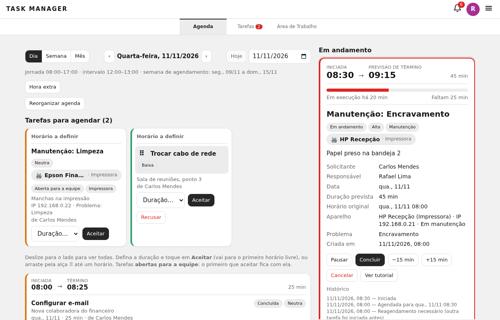
&nbsp;
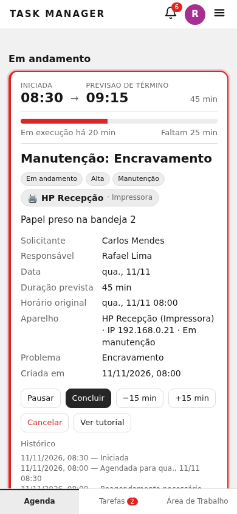

</div>

---

## Sumário

- [Visão geral](#visão-geral)
- [Funcionalidades](#funcionalidades)
- [Telas](#telas)
- [Como funciona](#como-funciona)
- [Arquitetura](#arquitetura)
- [Como rodar](#como-rodar)
- [Banco de dados (Supabase)](#banco-de-dados-supabase)
- [Testes](#testes)
- [Estrutura do projeto](#estrutura-do-projeto)
- [Scripts úteis](#scripts-úteis)
- [Limitações e próximos passos](#limitações-e-próximos-passos)

---

## Visão geral

O TASK MANAGER é um sistema web **multiempresa**, usado no celular (em campo) e no computador (na mesa).
Cada empresa tem seus dados isolados e três papéis:

| Papel | O que faz |
|---|---|
| **Administrador** | Cria a empresa, cadastra aparelhos, aceita membros (ou convida por link), define papéis e funções, endereço e feriados. Também pede e executa tarefas. |
| **Funcionário** | Recebe tarefas, define a duração, organiza a própria agenda, executa (iniciar, pausar, concluir com relato) e cuida dos aparelhos da sua função. |
| **Solicitante** | Pede tarefas (com ou sem aparelho), acompanha a agenda da equipe, a disponibilidade de cada um e o status dos aparelhos. |

A ideia central: **quem pede não precisa saber quando dá**. O solicitante descreve o problema; o funcionário só
informa quanto tempo leva e toca em **Aceitar** — o sistema encontra o horário, reorganiza pela urgência e avisa
todo mundo do que mudou.

## Funcionalidades

**Agenda inteligente**
- Encaixe automático pela urgência: tarefas mais urgentes passam na frente e as menos urgentes são empurradas, na mesma ordem.
- Respeita jornada, almoço (fixo ou sob demanda), folgas semanais e pontuais, ausências, horas extras e **feriados nacionais, estaduais e municipais** da cidade da empresa.
- Visões **Dia, Semana e Mês**, ir para qualquer data em dois toques, arrastar cartões para um horário.
- Uma tarefa em andamento por vez; **pausar** reserva só o tempo que falta e libera o lugar para outra; a reserva se reajusta sozinha.
- **Hora extra** programada (a agenda passa a usar esse tempo) e registrada automaticamente em cada tarefa.
- **Ausência parcial**, "ausente hoje" e **intervalo sob demanda** reorganizam o dia sem perder nada.
- Pausou depois do expediente? O sistema oferece levar a tarefa para ser **a primeira do próximo dia**.

**Tarefas**
- Tarefa direcionada a um funcionário ou **aberta para a equipe** (o primeiro que aceitar fica com ela).
- **Manutenção periódica**: ao concluir, a próxima já nasce marcada (a cada N dias, meses ou anos).
- Filtros por quem criou e por quem executa; histórico individual; notificações em tempo real.

**Área de Trabalho (aparelhos)**
- Aparelhos da empresa por categoria, com **status automático** (Inoperante → Em manutenção → Operacional) e **log** de tudo o que aconteceu.
- Organização livre arrastando (grupos, ordem), edição de nome/IP/categoria, alerta quando uma manutenção periódica está para vencer.
- Problemas pré-definidos por categoria e **tutoriais** passo a passo com fotos.

**Empresa e contas**
- Cadastro com **confirmação de e-mail**, login por e-mail ou nome de usuário, contas salvas no aparelho.
- Endereço pelo **CEP** (rua, bairro e cidade preenchidos sozinhos) e feriados da cidade carregados automaticamente.
- Tema claro e escuro.

## Telas

<table>
  <tr>
    <td width="50%">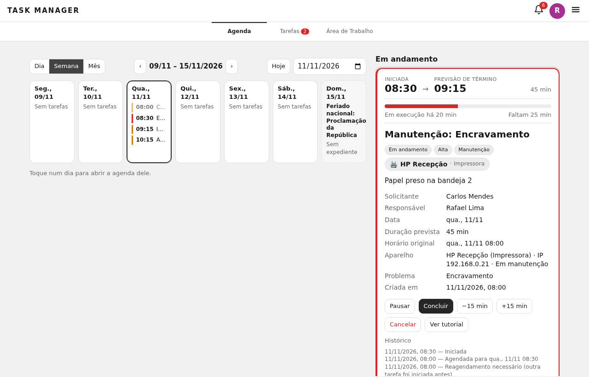<br><sub><b>Semana</b> — tarefas por dia e feriados (domingo, 15/11, sem expediente).</sub></td>
    <td width="50%">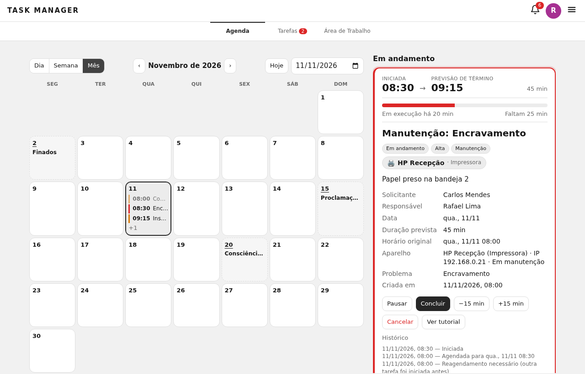<br><sub><b>Mês</b> — calendário com as tarefas e os feriados da cidade.</sub></td>
  </tr>
  <tr>
    <td>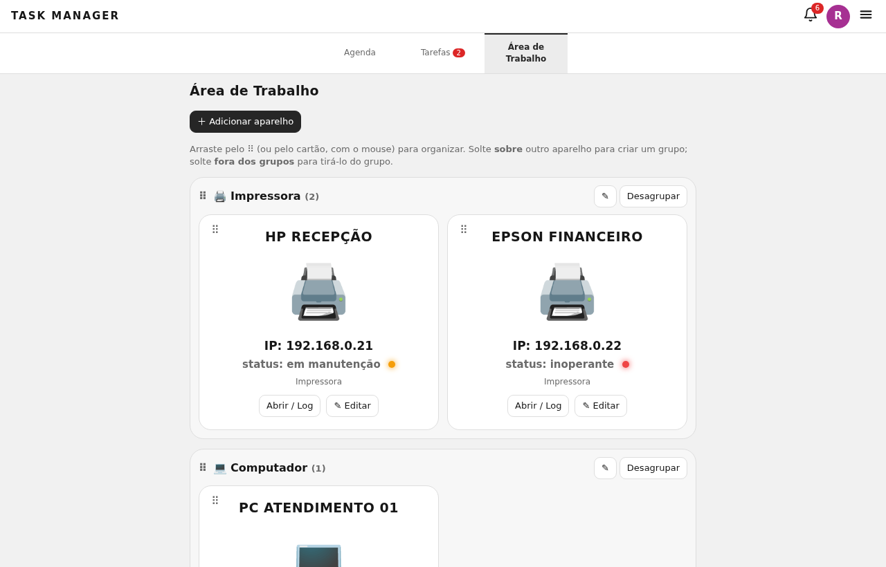<br><sub><b>Área de Trabalho</b> — aparelhos por categoria, com status em tempo real.</sub></td>
    <td>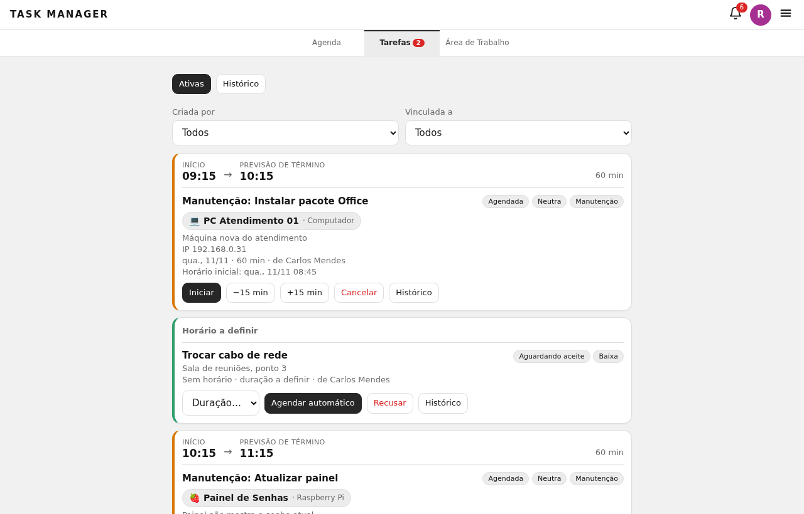<br><sub><b>Tarefas</b> — filtros "Criada por" e "Vinculada a"; aparelho em destaque em cada cartão.</sub></td>
  </tr>
  <tr>
    <td>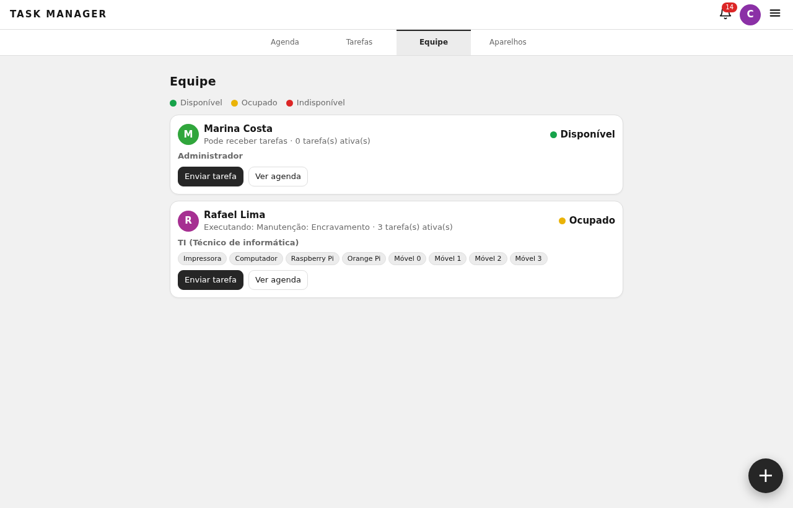<br><sub><b>Equipe</b> — quem está livre, ocupado (e com o quê) ou indisponível.</sub></td>
    <td>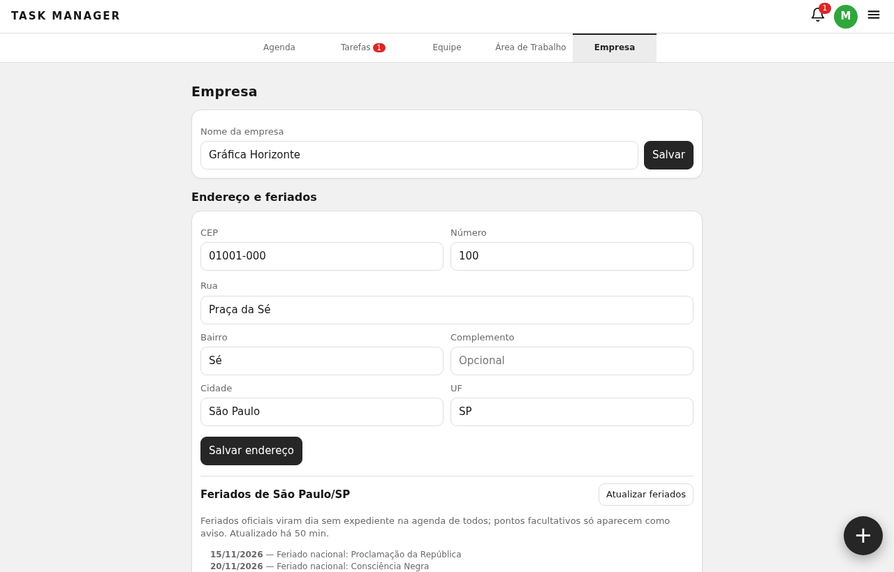<br><sub><b>Empresa</b> — endereço pelo CEP e feriados da cidade (administrador).</sub></td>
  </tr>
  <tr>
    <td>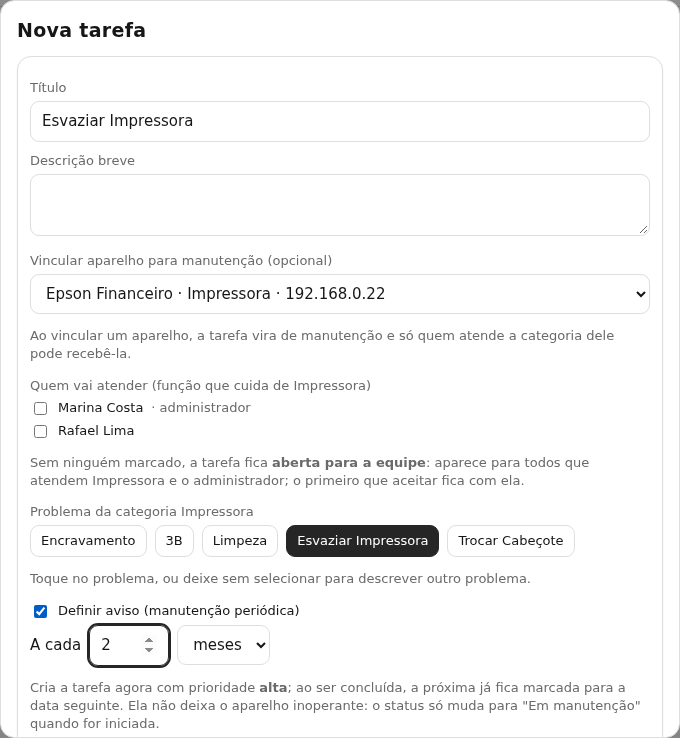<br><sub><b>Nova tarefa</b> — aparelho, problema da categoria e aviso periódico.</sub></td>
    <td>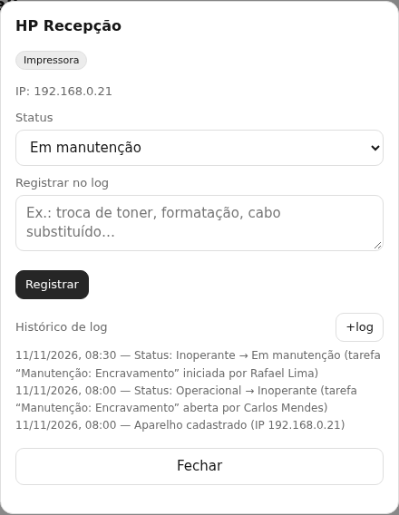<br><sub><b>Aparelho</b> — status e log automático de cada manutenção.</sub></td>
  </tr>
  <tr>
    <td>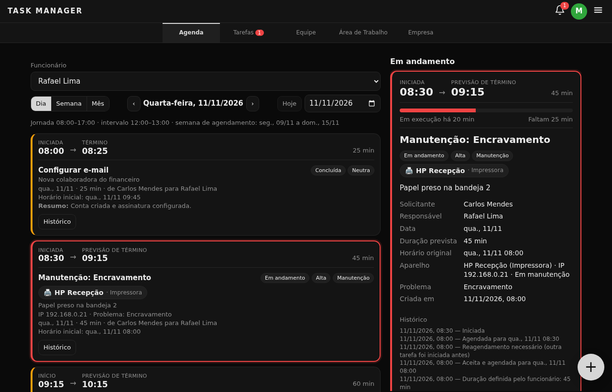<br><sub><b>Tema escuro</b> — agenda de um funcionário vista pela administradora.</sub></td>
    <td align="center">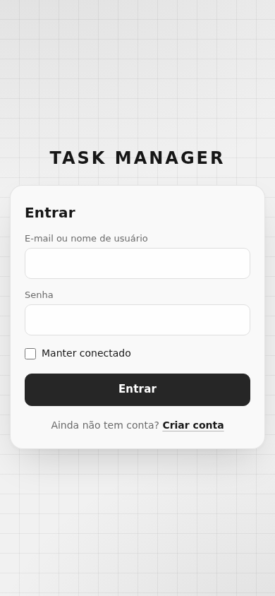<br><sub><b>Entrada</b> — no celular.</sub></td>
  </tr>
</table>

> As imagens são de uma empresa de demonstração com dados fictícios, geradas por [`scripts/capturas.py`](scripts/capturas.py).

## Como funciona

### Do pedido à execução

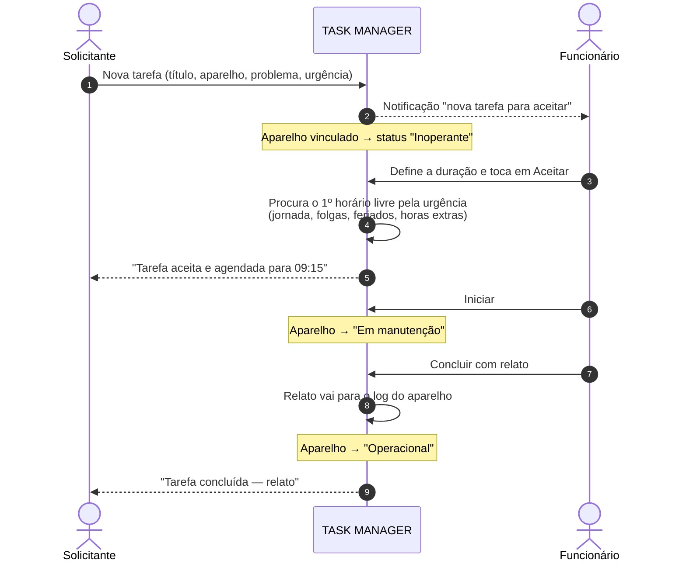

### Ciclo de vida de uma tarefa

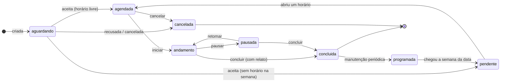

| Status | Significado |
|---|---|
| `aguardando` | Esperando o funcionário aceitar (ou alguém da equipe assumir, se estiver aberta). |
| `pendente` | Aceita, mas sem horário livre na semana — entra sozinha quando abrir espaço. |
| `agendada` | Com horário marcado na agenda. |
| `andamento` / `pausada` | Em execução. A pausada reserva só o tempo que falta e se reajusta até ser retomada. |
| `concluida` / `cancelada` | Encerrada (vai para o histórico). |
| `programada` | Próxima ocorrência de uma manutenção periódica, esperando a data. |

### Como a agenda encontra um horário

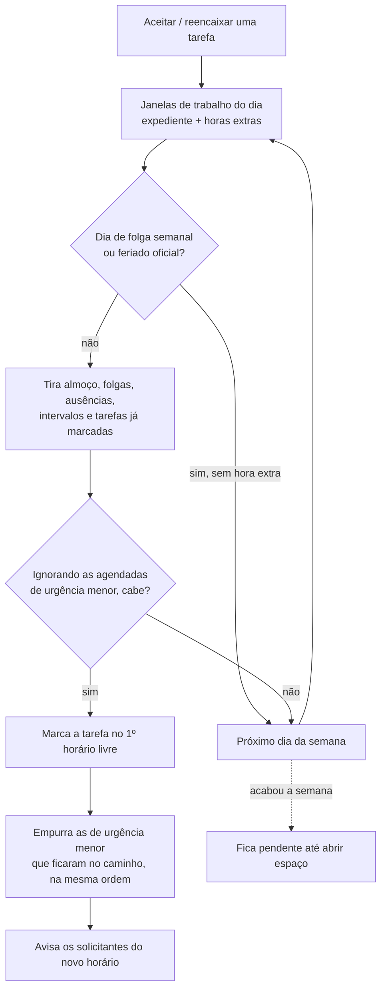

Regras que valem em toda a agenda:

- **Urgência primeiro, depois a ordem de chegada.** Tarefas já iniciadas e as de urgência igual ou maior não se mexem.
- **Nunca fora do expediente sozinho.** Só o próprio funcionário pode iniciar fora do horário — com confirmação — e
  o tempo trabalhado fora dele é registrado como hora extra.
- **Arrastar é escolha manual:** coloca a tarefa no horário escolhido sem reorganizar o resto.
- A agenda pode ser **vista** em qualquer data; o encaixe acontece na **semana atual**.

### Status do aparelho

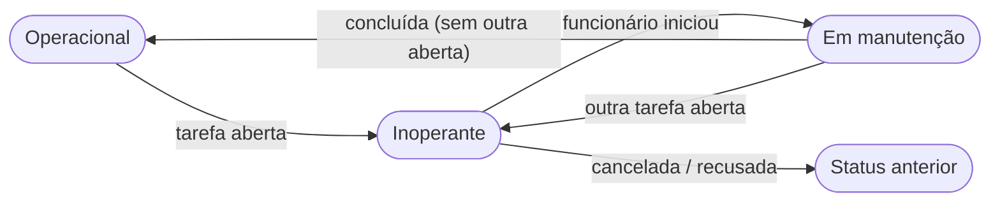

Manutenções periódicas não deixam o aparelho inoperante: ele só passa a "Em manutenção" quando o trabalho começa.
Toda mudança (e cada relato de conclusão) fica registrada no log do aparelho; solicitantes também podem anotar no log.

## Arquitetura

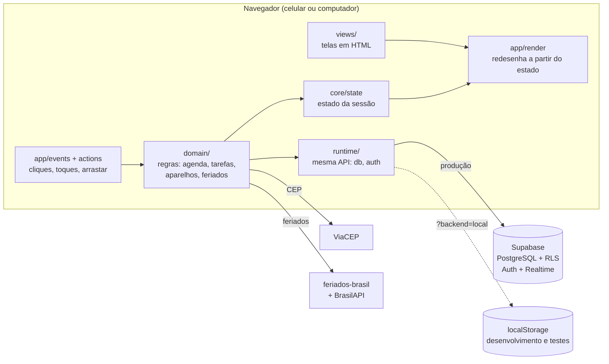

- **JavaScript puro, sem build:** scripts clássicos carregados em ordem pelo `index.html`; funciona em qualquer
  servidor estático (o site é publicado pelo GitHub Pages).
- **Um estado, uma renderização:** os dados chegam em tempo real do banco, montam o `state`, e `render()` redesenha a
  tela — preservando o que a pessoa está digitando.
- **Back-end trocável:** `js/runtime/` expõe a mesma API (`db`, `auth`) para o Supabase e para o modo local; as
  regras de negócio não sabem qual está em uso.
- **Segurança no banco:** cada tabela só mostra as linhas da empresa do usuário (RLS) e gatilhos impedem, por exemplo,
  que alguém se aprove sozinho ou mude o que não pode. Ações sensíveis (assumir tarefa aberta, entrar por convite,
  excluir conta/empresa, anotar no log) são funções do banco.

Detalhes do modelo de dados, das regras e das convenções do código estão em [CLAUDE.md](CLAUDE.md).
O contexto do produto está em [PRODUCT.md](PRODUCT.md) e o sistema visual em [DESIGN.md](DESIGN.md).

## Como rodar

Basta um servidor estático (Python já resolve):

```bash
python -m http.server 8000
# abra http://localhost:8000
```

Ou rode `iniciar.sh` (Linux/macOS) / `iniciar.bat` (Windows), ou use a extensão Live Server do VS Code.

Por padrão o sistema usa o **Supabase** do projeto. Para desenvolver sem internet e sem conta, abra com
**`?backend=local`** — os dados ficam no navegador (`localStorage`):

```
http://localhost:8000/?backend=local
```

## Banco de dados (Supabase)

Todo o esquema está em [`supabase/schema.sql`](supabase/schema.sql) — tabelas, permissões (RLS), gatilhos, funções,
tempo real e visões para relatórios (`v_tasks`, `v_devices`). O arquivo é **idempotente**: rode de novo sempre que mudar.

Para usar um projeto Supabase próprio:

1. Crie o projeto e execute `supabase/schema.sql` no SQL Editor.
2. Em [`js/runtime/config.js`](js/runtime/config.js), troque a URL e a chave **pública** (`anon`) do projeto.
3. Em *Authentication → URL Configuration*, use o endereço do site como *Site URL* e libere `<site>/**` nos redirects
   (o link de confirmação de e-mail abre [`confirmado.html`](confirmado.html)).
4. Para enviar e-mails de confirmação a usuários reais, configure um **SMTP próprio** em *Authentication → Emails*
   (o envio padrão do plano gratuito é limitado). Os modelos de e-mail em português estão em [`supabase/email/`](supabase/email/).

## Testes

```bash
python3 -m venv .venv && .venv/bin/pip install playwright && .venv/bin/playwright install chromium

.venv/bin/python tests/smoke.py          # cadastro e login (rápido)
.venv/bin/python tests/e2e.py            # fluxos completos, relógio fixo, modo local
.venv/bin/python tests/supabase_e2e.py   # integração real: vários navegadores, tempo real e permissões
```

- **`e2e.py`** percorre os fluxos de todos os papéis com o relógio fixo (incluindo celular emulado, pausas, intervalos,
  ausências, hora extra, feriados e manutenção periódica), com as APIs externas simuladas.
- **`supabase_e2e.py`** abre quatro navegadores ao mesmo tempo contra o Supabase real e confere tempo real,
  isolamento entre empresas e as regras de segurança; cria as contas de teste já confirmadas e apaga tudo no final
  (precisa de um token de acesso em `~/.supabase-token`).

## Estrutura do projeto

```
index.html            página principal (esqueleto + ordem dos scripts)
confirmado.html       página do link de confirmação de e-mail
css/styles.css        tema claro/escuro e componentes
js/runtime/           back-end: Supabase (produção) ou local (desenvolvimento/testes)
js/core/              utilitários, constantes e estado
js/domain/            regras de negócio: agenda, tarefas, empresa, feriados, aparelhos, organização, login
js/views/             telas e componentes (geram HTML)
js/app/               renderização, ações, eventos, arrastar e inicialização
supabase/             esquema SQL e modelos de e-mail
tests/                testes automatizados (Playwright)
scripts/              relatório de commits (.md e PDF) e capturas de tela do README
docs/img/             imagens do README
```

## Scripts úteis

| Comando | O que faz |
|---|---|
| `scripts/relatorio-commits.sh dia\|semana\|mes` | Relatório dos commits do período em Markdown (números, áreas alteradas, commits por dia). |
| `.venv/bin/python scripts/relatorio-pdf.py relatorios/<arquivo>.md` | Versão diagramada em PDF do relatório. |
| `/relatorio-commits` (Claude Code) | Gera o relatório com um resumo do que foi entregue e salva `.md` + `.pdf` em `relatorios/` (fora do git). |
| `.venv/bin/python scripts/capturas.py` | Refaz as imagens deste README a partir de uma empresa de demonstração. |

## Limitações e próximos passos

- As regras de agenda rodam no navegador; o banco garante **quem** pode alterar o quê, mas não valida a lógica de
  encaixe. Próximo passo: mover as ações críticas para funções do banco.
- Fotos dos tutoriais ficam no próprio banco (como texto); para muitas fotos, o ideal é o Supabase Storage.
- Só a categoria **Impressora** vem com problemas pré-definidos; os tutoriais estão prontos, mas ainda sem conteúdo.
- Envio de e-mails de confirmação para usuários reais depende de um SMTP próprio.
